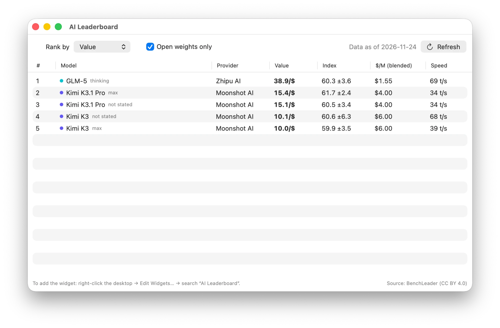

<p align="center">
  
</p>

# AI Leaderboard: a macOS widget

A native macOS desktop / Notification Center widget that shows the current AI model standings, refreshed every hour. Choose from three data sources:

| Source | What it ranks | Models |
| --- | --- | --- |
| **[BenchLeader](https://www.benchleader.com)** | Benchmark results combined into one index, plus price and speed | Top 100 model configurations, open and closed |
| **[LMArena](https://lmarena.ai/leaderboard)**, via its [Hugging Face dataset](https://huggingface.co/datasets/lmarena-ai/leaderboard-dataset) | Which answer people prefer in blind, head-to-head votes | About 430 models, open and closed |
| **[Hugging Face Hub](https://huggingface.co/models?pipeline_tag=text-generation&sort=trending)** | Popularity: trending, downloads or likes | Every text-generation model on the Hub (open models only) |

> **Unofficial.** This project isn't affiliated with or endorsed by BenchLeader, LMArena or Hugging Face. It only reads data they publish publicly.

## Features

### The widget


*The widget gallery (right-click the desktop → Edit Widgets…). The gallery previews use the last saved data, or a short built-in sample before the first download. That's why this one reads "6 ranked".*

The widget comes in four sizes:

| Size | Shows |
| --- | --- |
| Small | Top 4: rank, provider dot, model name, score |
| Medium | Top 5 with provider, price and reasoning effort |
| Large | Top 12 |
| Extra-large | Top 24, in two columns |

What each part of the widget means:

- **Header:** the source and ranking you picked (for example "BenchLeader · Overall" or "LMArena · Coding"), "open" if you're showing only open-weights models, your **Show only** filter if you set one, and the date of the data. If the latest download failed, the date is followed by **(cached)** and the widget shows the last data it saved.
- **Rank number:** the model's position in the ranking you picked. The leader's rank and score are shown in purple.
- **Coloured dot:** the provider. Anthropic is orange, Google blue, OpenAI green, Meta dark blue, Alibaba amber, Moonshot AI indigo, Zhipu AI teal, Mistral red-orange, NVIDIA lime and xAI grey; others are purple.
- **Effort badge:** the reasoning effort the model was tested at (for example `max`, `xhigh`, `high`). BenchLeader and LMArena rank each model + effort pair separately, so a model can appear more than once.
- **Second line:** depends on the source:
  - BenchLeader: provider and blended price per million tokens, plus the overall index (`idx`) when you rank by something else.
  - LMArena: provider and number of votes.
  - Hugging Face: provider, downloads in the last 30 days, and likes.
- **Score (right):** the value for the ranking you picked (see [Rankings by source](#rankings-by-source)).
- **Footer:** the data credit (for example "Source: BenchLeader (CC BY 4.0)") and how many models match your settings.
- **Clicking:** click a row to open that model's page (on benchleader.com or huggingface.co; LMArena rows open its leaderboard). Click anywhere else to open the source's homepage.
- **Updates:** the widget refreshes every hour. If a download fails, it tries again in 15 minutes.

**Settings:** right-click the widget → **Edit "AI Leaderboard"** to choose:

- **Source:** BenchLeader, LMArena or Hugging Face Hub. The options below change to match.
- **Rank by** (BenchLeader), **Category** (LMArena) or **Sort by** (Hugging Face): which ranking to show.
- **Open-weights models only** (BenchLeader and LMArena): hides closed models. Every Hugging Face model is already open.
- **Show only:** type a model or provider name, such as `Claude`, `Sonnet` or `OpenAI, Google`, to show only matching models. It uses the same rules as [search in the app](#search). Leave it empty to show everything.

Each widget you place has its own settings. For example, you could keep a BenchLeader Overall widget next to an LMArena Coding widget and a Hugging Face Trending one.

### The companion app

The app shows the full list from each source in a table, with the same options as the widget. You need to open it once after installing so macOS registers the widget.

*The screenshots below show the BenchLeader source. The app now also has a Source switch at the top left, and the date has moved to the footer.*


*Ranking by Value: the BenchLeader Index divided by the blended price. Cheaper models that still score well rise to the top.*



*With "Open weights only" turned on, only models whose weights are publicly downloadable are shown.*

- **Source** (top left): BenchLeader, LMArena or Hugging Face.
- **Search** (top right, or press ⌘F): filters the table as you type (see [Search](#search)). "N of M match" shows how many rows are left.
- **Rank by / Category / Sort by:** picks the ranking for the current source (see [Rankings by source](#rankings-by-source)).
- **Open weights only** (BenchLeader and LMArena): hides closed models.
- **Refresh:** downloads the latest data and also tells every placed widget to update straight away.
- **Footer:** the date the data was published and a link to the source.

Table columns. The first four are the same for every source:

| Column | Meaning |
| --- | --- |
| **#** | Position in the ranking you picked |
| **Model** | Model name, provider dot and reasoning effort. "not stated" means the source didn't report the effort setting. |
| **Provider** | The lab or person that published the model |
| **(Score column)** | The value being ranked on. Its title changes with the ranking. |

The last three depend on the source:

| Source | Columns |
| --- | --- |
| BenchLeader | **Index** with its uncertainty (`±` is roughly a 95% range; overlapping models are effectively tied), **$/M (blended)** (US dollars per million tokens, 3 input : 1 output), **Speed** (median output tokens per second; "—" if not measured) |
| LMArena | **95% range** (how far the score could move; overlapping models are effectively tied), **Votes** (how many head-to-head votes the score is based on), **Licence** ("Proprietary" for closed models) |
| Hugging Face | **Downloads (30 days)**, **Likes**, **Updated** (when the model's files last changed) |

### Search

The app's search box and the widget's **Show only** setting work the same way:

| You type | You get |
| --- | --- |
| `claude` or `anthropic` | Every Anthropic configuration |
| `sonnet` | Only Claude Sonnet models |
| `opus 5.5` | Claude Opus 5.5 at every reasoning effort. When you type several words, a model must match all of them. |
| `openai max` | OpenAI models benchmarked at `max` effort |
| `anthropic, google` | Anthropic **or** Google models. Commas separate alternatives. |
| `gpt6` | GPT-6, GPT-6.1, GPT-6.2… Case, spaces and punctuation are ignored. |
| `llama 3.1` | Llama 3.1 models only. A word that is just a number must match a whole version number, so `gpt 6` doesn't find GPT-5.6 and `llama 4` doesn't find Llama 3.1 405B or a "4bit" build. |

A search looks at the model name, provider and reasoning effort. Numbers attached to letters, like sizes and quantization labels ("8B", "4bit", "INT4"), aren't treated as versions. To find a name like Qwen3, type it as one word: `qwen3`.

Matching models keep their position in the full ranking, so a search for `claude` shows #1, #3, #7… and you can still see where each one stands overall.

**Hugging Face searches work differently.** The Hub has far too many models for one list, so the search goes to Hugging Face itself. It covers every text-generation model on the Hub, not just the top 100. The app then applies the rules above, and **#** becomes the position within the search results. Hugging Face's own search is loose, so results depend partly on how it matches names.

### Rankings by source

**BenchLeader** (Rank by):

| Ranking | What it sorts by |
| --- | --- |
| **Overall** | BenchLeader's own rank on the BenchLeader Index, which combines results from many benchmarks. 50 is the average model; every 15 points is one standard deviation. |
| **Coding, Agents, Reasoning, Math, Knowledge** | BenchLeader's score for that category, on the same scale as the index. Models without enough results in a category are left out of that ranking. |
| **Speed** | Typical (median) output speed in tokens per second |
| **Value** | Index points per dollar: the index divided by the blended price per million tokens |

All BenchLeader rankings use the same 100 rows from BenchLeader's data file. Every ranking except Overall is worked out by this app, not by BenchLeader. Ties are broken by overall rank.

**LMArena** (Category): Overall, Coding, Math, Expert, English, Creative writing, Hard prompts, Instruction following, Multi-turn, Longer queries and Non-English. Each is LMArena's own leaderboard for that kind of prompt. The **Arena score** is an Elo-style rating from blind votes between two anonymous models; a gap of about 100 points means people prefer the higher model's answer roughly 64% of the time. The rank is LMArena's own, so tied models can share a number. "Open weights only" keeps models with any licence other than "Proprietary".

**Hugging Face** (Sort by):

| Sort | What it sorts by |
| --- | --- |
| **Trending** | The Hub's trending score: recent growth in likes and downloads |
| **Downloads** | Downloads in the last 30 days |
| **Likes** | All-time likes |

The Hugging Face list covers text-generation models only. Some well-known models are tagged as image-and-text models instead (for example Llama 4 and Gemma 3), so they aren't in this list. It measures popularity, not quality.

## Install (prebuilt)

1. Download `AI-Leaderboard.zip` from the [latest release](../../releases/latest) and unzip it.
2. Move `BenchLeader.app` to `/Applications` or `~/Applications`.
3. The app isn't signed with an Apple Developer ID, so macOS will block it the first time. Either:
   - try to open it, then go to **System Settings → Privacy & Security** and click **Open Anyway**, or
   - run: `xattr -dr com.apple.quarantine ~/Applications/BenchLeader.app` (adjust the path if needed).
4. Open the app once so macOS registers the widget.
5. Right-click the desktop → **Edit Widgets…** → search for **AI Leaderboard**.

To change the ranking, right-click the widget → **Edit "AI Leaderboard"**.

## Build from source

Requirements: macOS 14 or later and Xcode 16 or later. You don't need an Apple Developer account.

```bash
git clone https://github.com/actuallyhrishikesh/ai-leaderboard-widget.git
cd ai-leaderboard-widget
xcodebuild -project BenchLeader.xcodeproj -scheme BenchLeader -configuration Release -derivedDataPath build build
cp -R build/Build/Products/Release/BenchLeader.app ~/Applications/
open ~/Applications/BenchLeader.app
```

Or open `BenchLeader.xcodeproj` in Xcode and run the **BenchLeader** scheme. The project is ad-hoc signed ("Sign to Run Locally"). To distribute your own build without Gatekeeper warnings, set your team in Signing & Capabilities and notarize it.

## How it works

| Path | Contents |
| --- | --- |
| `Shared/Leaderboard.swift` | BenchLeader data model, rankings and fetching; search matching; provider colours |
| `Shared/Sources.swift` | The source switch, LMArena and Hugging Face fetching, and the common list format the app and widget display |
| `Widget/BenchLeaderWidget.swift` | WidgetKit extension: configuration (with per-source options), timeline provider, views |
| `BenchLeader/BenchLeaderApp.swift` | Host app with the full table |
| `BenchLeader/AppIcon.icon` | App icon in Icon Composer format. macOS 26 applies its own rounded-square outline; Xcode also generates the icon file used by older macOS versions. |
| `Config/` | Widget `Info.plist` and sandbox entitlements (network client only) |

Where the data comes from:

- **BenchLeader:** [`https://www.benchleader.com/data/leaderboard.json`](https://www.benchleader.com/data/leaderboard.json), the top 100 model configurations on the BenchLeader Index. A configuration is one model at one reasoning effort. Rankings other than Overall re-sort those 100 rows, so they aren't BenchLeader's full category leaderboards.
- **LMArena:** the `text` leaderboard in the [`lmarena-ai/leaderboard-dataset`](https://huggingface.co/datasets/lmarena-ai/leaderboard-dataset) dataset, read through Hugging Face's [dataset viewer API](https://huggingface.co/docs/dataset-viewer) 100 rows at a time. A widget without filters fetches only the first 100 rows. Requests are retried up to three times, because that API occasionally stalls.
- **Hugging Face Hub:** the [Hub models API](https://huggingface.co/docs/hub/api), limited to `text-generation` models: the top 100 for the chosen sort, or a server-side search when you search.

Each source's last full download is saved, so the widget and app can show it (marked "cached") when you're offline. Hugging Face searches aren't saved.

## Data and licensing

- The **code** in this repository is released under the [MIT License](LICENSE).
- The **data** isn't included in this repository; the app and widget download it at runtime and credit the source on screen.
  - **BenchLeader:** computed figures (the index, its interval, category scores and rank) are published under [CC BY 4.0](https://creativecommons.org/licenses/by/4.0/). Prices, speeds and benchmark results remain under their original publishers' terms. See BenchLeader's [methodology page](https://www.benchleader.com/methodology).
  - **LMArena:** the leaderboard dataset is published under [CC BY 4.0](https://creativecommons.org/licenses/by/4.0/).
  - **Hugging Face Hub:** model names and statistics come from the public Hub API, under the [Hugging Face terms](https://huggingface.co/terms-of-service). Each model has its own licence, shown on its Hub page.
