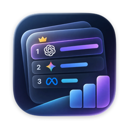
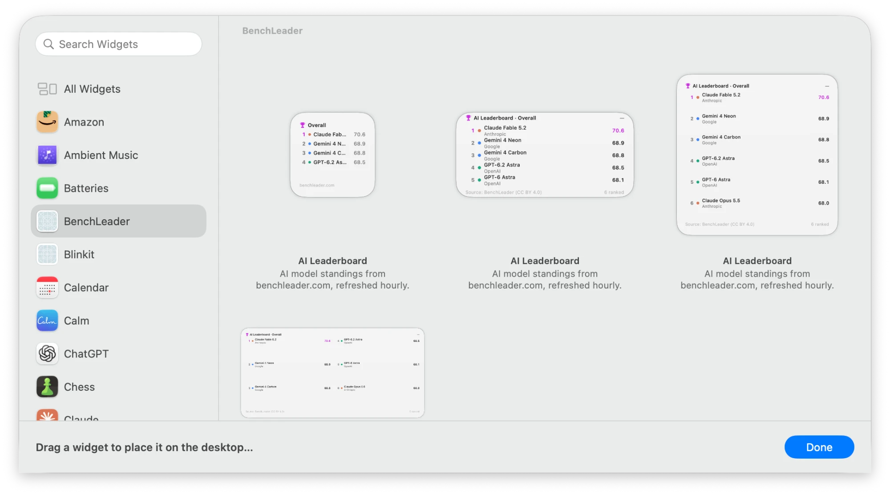
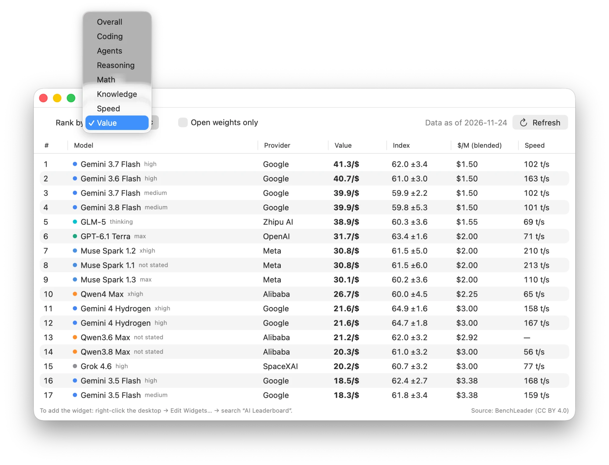

<p align="center">
  
</p>

# AI Leaderboard: a macOS widget

A native macOS desktop / Notification Center widget that shows the current AI model standings from [BenchLeader](https://www.benchleader.com), refreshed every hour.

> **Unofficial.** This project isn't affiliated with or endorsed by BenchLeader. It only reads the public data file they publish for reuse.

## Features

### The widget



*The widget gallery (right-click the desktop → Edit Widgets…). The gallery previews use the last saved data, or a short built-in sample before the first download. That's why this one reads "6 ranked".*

The widget comes in four sizes:

| Size | Shows |
| --- | --- |
| Small | Top 4: rank, provider dot, model name, score |
| Medium | Top 5 with provider, price and reasoning effort |
| Large | Top 12 |
| Extra-large | Top 24, in two columns |

What each part of the widget means:

- **Header:** the ranking you picked (for example "AI Leaderboard · Overall"), "open" if you're showing only open-weights models, your **Show only** filter if you set one, and the date of the data. If the latest download failed, the date is followed by **(cached)** and the widget shows the last data it saved.
- **Rank number:** the model's position in the ranking you picked. The leader's rank and score are shown in purple.
- **Coloured dot:** the provider. Anthropic is orange, Google blue, OpenAI green, Meta dark blue, Alibaba amber, Moonshot AI indigo, Zhipu AI teal and xAI grey; others are purple.
- **Effort badge:** the reasoning effort the model was benchmarked at (for example `max`, `xhigh`, `high`). BenchLeader ranks each model + effort pair separately, so a model can appear more than once.
- **Second line:** the provider and the blended price per million tokens. When you rank by anything other than Overall, it also shows the model's overall index (`idx`).
- **Score (right):** the value for the ranking you picked (see [Rankings](#rankings)).
- **Footer:** the data credit ("Source: BenchLeader (CC BY 4.0)") and how many models match your settings.
- **Clicking:** click a row to open that model's page on benchleader.com. Click anywhere else to open the homepage.
- **Updates:** the widget refreshes every hour, a few minutes after BenchLeader's own hourly update. If a download fails, it tries again in 15 minutes.

**Settings:** right-click the widget → **Edit "AI Leaderboard"** to choose:

- **Rank by:** which ranking to show.
- **Open-weights models only:** hides closed models.
- **Show only:** type a model or provider name, such as `Claude`, `Sonnet` or `OpenAI, Google`, to show only matching models. It uses the same rules as [search in the app](#search). Leave it empty to show everything.

Each widget you place has its own settings. For example, you could keep an Overall widget next to a "Claude" widget ranked by Coding.

### The companion app

The app shows all 100 rows in a table with the same options as the widget. You need to open it once after installing so macOS registers the widget.



*Ranking by Value: the BenchLeader Index divided by the blended price. Cheaper models that still score well rise to the top.*


*With "Open weights only" turned on, only models whose weights are publicly downloadable are shown.*

- **Search** (top right, or press ⌘F): filters the table as you type (see [Search](#search)). "N of 100 match" shows how many rows are left.
- **Rank by:** picks the ranking (see below). The highlighted column updates to match.
- **Open weights only:** hides closed models.
- **Data as of:** the date BenchLeader published the data.
- **Refresh:** downloads the latest data and also tells every placed widget to update straight away.

Table columns:

| Column | Meaning |
| --- | --- |
| **#** | Position in the ranking you picked |
| **Model** | Model name, provider dot and reasoning effort. "not stated" means the benchmark sources didn't report the effort setting. |
| **Provider** | The lab that makes the model |
| **(Ranking column)** | The score being ranked on. Its title changes with **Rank by**. |
| **Index** | The BenchLeader Index with its uncertainty (`±` is roughly a 95% range). Models whose ranges overlap are effectively tied. |
| **$/M (blended)** | US dollars per million tokens, blended at 3 input tokens : 1 output token |
| **Speed** | Typical (median) output speed in tokens per second. "—" means it hasn't been measured. |

### Search

The app's search box and the widget's **Show only** setting work the same way:

| You type | You get |
| --- | --- |
| `claude` or `anthropic` | Every Anthropic configuration |
| `sonnet` | Only Claude Sonnet models |
| `opus 5.5` | Claude Opus 5.5 at every reasoning effort. When you type several words, a model must match all of them. |
| `openai max` | OpenAI models benchmarked at `max` effort |
| `anthropic, google` | Anthropic **or** Google models. Commas separate alternatives. |
| `gpt6` | GPT-6, GPT-6.1, GPT-6.2… Case, spaces and punctuation are ignored. |

A search looks at the model name, provider and reasoning effort. Matching models keep their position in the full ranking, so a search for `claude` shows #1, #3, #7… and you can still see where each one stands overall.

### Rankings

| Ranking | What it sorts by |
| --- | --- |
| **Overall** | BenchLeader's own rank on the BenchLeader Index, which combines results from many benchmarks. 50 is the average model; every 15 points is one standard deviation. |
| **Coding, Agents, Reasoning, Math, Knowledge** | BenchLeader's score for that category, on the same scale as the index. Models without enough results in a category are left out of that ranking. |
| **Speed** | Typical (median) output speed in tokens per second |
| **Value** | Index points per dollar: the index divided by the blended price per million tokens |

All rankings use the same 100 rows from BenchLeader's data file. Every ranking except Overall is worked out by this app, not by BenchLeader. Ties are broken by overall rank.

## Install (prebuilt)

1. Download `AI-Leaderboard.zip` from the [latest release](../../releases/latest) and unzip it.
2. Move `BenchLeader.app` to `/Applications` or `~/Applications`.
3. The app isn't signed with an Apple Developer ID, so macOS will block it the first time. Either:
   - try to open it, then go to **System Settings → Privacy & Security** and click **Open Anyway**, or
   - run: `xattr -dr com.apple.quarantine ~/Applications/BenchLeader.app` (adjust the path if needed).
4. Open the app once so macOS registers the widget.
5. Right-click the desktop → **Edit Widgets…** → search for **AI Leaderboard**.

To change the ranking, right-click the widget → **Edit "AI Leaderboard"**.

## Build from source

Requirements: macOS 14 or later and Xcode 16 or later. You don't need an Apple Developer account.

```bash
git clone https://github.com/actuallyhrishikesh/ai-leaderboard-widget.git
cd ai-leaderboard-widget
xcodebuild -project BenchLeader.xcodeproj -scheme BenchLeader -configuration Release -derivedDataPath build build
cp -R build/Build/Products/Release/BenchLeader.app ~/Applications/
open ~/Applications/BenchLeader.app
```

Or open `BenchLeader.xcodeproj` in Xcode and run the **BenchLeader** scheme. The project is ad-hoc signed ("Sign to Run Locally"). To distribute your own build without Gatekeeper warnings, set your team in Signing & Capabilities and notarize it.

## How it works

| Path | Contents |
| --- | --- |
| `Shared/Leaderboard.swift` | Data model, ranking logic, fetching and on-disk cache (used by both targets) |
| `Widget/BenchLeaderWidget.swift` | WidgetKit extension: configuration intent, timeline provider, views |
| `BenchLeader/BenchLeaderApp.swift` | Host app with the full table |
| `BenchLeader/AppIcon.icon` | App icon in Icon Composer format. macOS 26 applies its own rounded-square outline; Xcode also generates the icon file used by older macOS versions. |
| `Config/` | Widget `Info.plist` and sandbox entitlements (network client only) |

The widget fetches [`https://www.benchleader.com/data/leaderboard.json`](https://www.benchleader.com/data/leaderboard.json), the top 100 model configurations on the BenchLeader Index. A configuration is one model at one reasoning effort. Rankings other than Overall re-sort those 100 rows, so they aren't BenchLeader's full category leaderboards.

## Data and licensing

- The **code** in this repository is released under the [MIT License](LICENSE).
- The **data** isn't included in this repository; the widget downloads it at runtime. BenchLeader's computed figures (the index, its interval, category scores and rank) are published under [CC BY 4.0](https://creativecommons.org/licenses/by/4.0/), and the widget credits "BenchLeader" on screen. Prices, speeds and benchmark results remain under their original publishers' terms. See BenchLeader's [methodology page](https://www.benchleader.com/methodology) for details.
